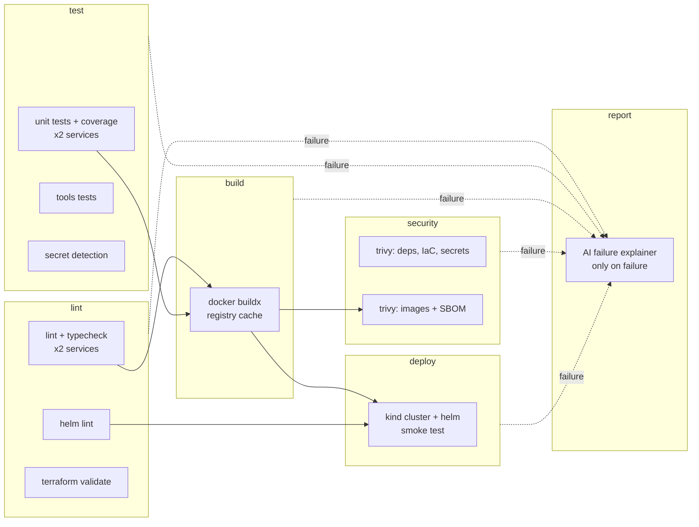

# AI-Native Delivery Pipeline

A GitLab CI/CD pipeline for a small microservices app (TaskManager), built to
explore one question: **how do we get code to production quickly, safely, and
with less friction for the engineers who write it?**

Every merge request is linted, tested, built into container images, scanned
for security issues, deployed to a throwaway Kubernetes cluster and smoke
tested. When something fails, an AI step reads the failed job logs and posts
a short explanation of the likely cause on the merge request, so the developer
doesn't have to dig through hundreds of log lines first.

## The pipeline



| Stage | What runs | Why |
| --- | --- | --- |
| lint | ESLint + `tsc` per service, `helm lint`, `terraform fmt/validate` | Cheap checks first, so obvious mistakes fail in seconds |
| test | Vitest unit tests with coverage, pytest for the tooling, GitLab secret detection | Test results and coverage show up directly in the MR |
| build | `docker buildx` with a registry layer cache, images tagged with the commit SHA | Unchanged layers are reused, so rebuilds are fast; every image traces back to a commit |
| security | Trivy on the repo (dependencies, Dockerfile/Helm/Terraform misconfigurations, secrets) and on each image, plus a CycloneDX SBOM | Fails on HIGH/CRITICAL issues that have a fix; the SBOM is attached to the pipeline |
| deploy | A kind cluster inside docker-in-docker, Helm install, end-to-end smoke test | Proves the images actually start and talk to each other before anything is merged |
| report | AI failure explainer | Turns a red pipeline into a readable "here is probably why" comment |

Jobs run as a DAG (`needs`), so tests don't wait for lint, and the two services
are built and tested in parallel with `parallel:matrix`.

## The AI failure explainer

`tools/explain_failure.py` runs in the last stage, only when an earlier job
failed and only if the API keys are configured.

1. Lists the failed jobs in the pipeline through the GitLab API (allowed failures are ignored).
2. Downloads each job log and keeps only the end, where the error usually is.
3. **Removes secrets before anything leaves GitLab**: values of secret-looking
   CI variables, and known token formats (GitLab, GitHub, AWS, Anthropic and
   OpenAI keys, bearer tokens, `password=...`, private keys).
4. Sends the cleaned logs to an LLM and asks for the root cause, the log lines
   that show it, and a concrete fix.
5. Posts the answer as a merge request comment and saves it as an artifact.

Design choices:

- **It never blocks the pipeline** (`allow_failure: true`). If the LLM is down,
  developers still have the normal logs.
- **It suggests, it doesn't act.** No automatic retries or commits; every
  comment says it was generated by an LLM and should be checked.
- **Dry run without a key**: it prints the exact prompt it would send, which
  makes it easy to review what data leaves the pipeline.
- The model is configurable with `AI_MODEL`.

## Repository layout

```
services/task-service   REST API for tasks (TypeScript, Express, MongoDB)
services/web-gateway    serves the UI and forwards /api to task-service
deploy/helm/taskmanager Helm chart (non-root, read-only filesystem, probes, limits)
deploy/kind             kind cluster config used in CI
deploy/smoke-test.sh    end-to-end test through the gateway
infra/terraform         local environment as code: kind cluster + Helm release
tools/                  AI failure explainer and pipeline metrics, with tests
```

## Run it on GitLab

1. Create a GitLab project and push this repository.
2. In **Settings → CI/CD → Variables**, add (masked and protected):
   - `ANTHROPIC_API_KEY`: an Anthropic API key.
   - `GITLAB_API_TOKEN`: a project access token with the `api` scope and the
     Developer role, so it can read job logs and comment on merge requests.
3. Open a merge request. To see the AI explainer, break something on purpose
   (a failing test is enough) and check the MR comments.

Without the two variables the pipeline still runs; only the AI step is skipped.

## Run it locally

Requirements: Node 22, Python 3.12+, Docker, kind, kubectl, Terraform.

```bash
make install   # dependencies
make check     # the same lint + tests as CI
make up        # kind cluster + images + Helm release via Terraform
make smoke     # end-to-end test
make down      # delete the cluster
```

## Measuring the pipeline

`tools/pipeline_stats.py` reads recent pipelines from the GitLab API and prints
the success rate, median duration and the slowest jobs. I use it to compare
before and after a change, for example enabling the build cache.

```bash
GITLAB_API_TOKEN=... python tools/pipeline_stats.py <project-id> --ref main --last 30
```

## What I would do next

- Pin every CI image by digest and update them with Renovate.
- Sign images (cosign) and verify signatures before deploy.
- Review apps: keep the per-MR environment running with a URL in the MR.
- Use the explainer's output to spot flaky tests across many pipelines.

## Author

Adriana Calvo Bueno · [LinkedIn](https://www.linkedin.com/in/adriana-calvo-bueno/) · [adcbueno.github.io](https://adcbueno.github.io/)
